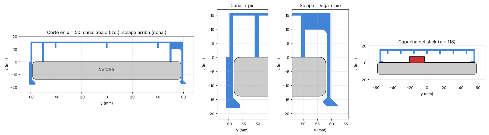

# Visera frontal — Nintendo Switch 2

Tapa frontal de una pieza: capuchas rígidas que protegen los joysticks y botones, y una
piel fina sobre la pantalla contra rayones (la pantalla ya lleva cristal templado).
La capucha cubre cada Joy-Con 2 entero, así que no hay agujeros que alinear con los sticks
(el problema número uno de otros modelos).

## Archivos

| Archivo | Uso | Peso PLA / PETG |
|---|---|---|
| `visera_switch2_A1_PETG.3mf` | **Recomendado.** Proyecto Bambu Studio: A1 0.4, PETG HF, placa PEI texturizada | — / ~132 g |
| `visera_switch2_A1_PLA.3mf` | Igual con PLA Basic | ~129 g / — |
| `stl/test_grip.stl` | **Imprímelo primero**: tramo de 40 mm con el canal inferior y la solapa | ~17 g |
| `stl/test_hood.stl` | Capucha sobre el stick + pared del extremo | ~28 g |
| `stl/a1_diag.stl` | Visera ya girada 45° y boca abajo (249,6 × 249,6 mm) | ~129 / 132 g |
| `stl/full.stl` | La misma sin girar (para mirarla) | |

Los 3MF llevan: capa 0,2 mm, 4 paredes, gyroid 25 %, sin soportes, sin brim.
Se generan con `python3 tools/make_3mf.py stl/a1_diag.stl salida.3mf --filament pla|petg`.
No se han podido abrir en Bambu Studio desde este entorno: si algo no carga, abre `stl/a1_diag.stl`.
Todas las piezas se imprimen boca abajo **sin soportes** (todos los voladizos son de 45°).

**Por qué cabe en la A1:** a 45° un cuadrado de 256 mm admite piezas de ~360 mm si las
esquinas están redondeadas (`cover_r` ≈ 35 mm, calculado a partir de `bed`).

## Sujeción (v2)

1. **Canal rígido abajo** (192 mm): abraza el borde inferior y engancha 2,6 mm detrás de la
   consola con un labio a 45°. No flexa.
2. **Solapa ancha arriba** (115 mm, x = −25…90): pared de 1,2 mm colgada de una viga de
   6 × 8 mm con redondeo en la raíz; diente a 45° (entrada y retención) que engancha 1,2 mm
   detrás. Es lo único que flexa. Pestaña hacia fuera para soltarla.
3. **Pies de apoyo** continuos sobre el marco, arriba y abajo, y **paredes de centrado** en los
   extremos de los Joy-Con.

**Poner:** mete el borde inferior de la consola en el canal (inclinada) y baja la visera
hasta que la solapa hace clic. **Quitar:** tira de la pestaña y gira la visera hacia abajo.

Comprobado en 2D (`img/corte_sujecion.png`): al cerrar, la consola no choca con ninguna parte
rígida; solo abre la solapa ~1,6 mm. Ajustes: `flap_hook` (agarre arriba), `chan_lip` (abajo),
`tol`. Comprueba en tu consola que el tramo `flap_x` no tapa el botón de encendido ni el volumen.

> Versión anterior (dedos de agarre): el hueco de la consola llegaba 10 mm detrás de ella y
> borraba los ganchos, por eso no agarraba. Corregido: el hueco acaba en la cara trasera.

## Estructura

- **Pantalla:** piel maciza de 1 mm (5 capas, sin agujeros) + nervios bajos cada 40 mm; queda
  a ~14 mm del cristal. `screen_style = "ribbed"` recupera el panel profundo antiaplastamiento.
- **Capuchas:** techo de 2,6 mm + panal de 3,4 mm (nervios de 1,8 mm) + refuerzo a 45° en la
  pared de apoyo. Quedan 2,6 mm de aire sobre la punta del stick y sobre todos los botones.
- **Grosor** con la consola: ~29 mm por delante y detrás, +3,8 mm de labios en los bordes.

## Simulaciones

FEA lineal con CalculiX (C3D10, malla gmsh) en `sim/` (`sim/run_all.sh`). Material impreso
conservador: PLA E = 3000 MPa, 45 MPa en el plano y 25 MPa entre capas; PETG 1900 MPa,
40 / 28 MPa. Margen = resistencia / tensión máxima.

| Caso | Tensión máx. | Margen PLA | Margen PETG | Resultado |
|---|---|---|---|---|
| Rodilla 30 kg sobre la capucha del stick | 33 MPa | 1,4× | ~1,2× (dúctil) | baja 0,35 mm de 2,6: no toca |
| Cerrar/abrir la solapa (diente se abre 1,2 mm) | 9,1 MPa entre capas | **2,7×** | **4,6×** | — |

La solapa se analiza en una franja del corte real (`sim/profile_occ.py`, deformación plana,
apoyada en la cara de la consola y sujeta por el canal). Sin los pies de apoyo esa franja no
tocaba la consola y la tensión se disparaba: por eso existen.

Limitaciones: análisis lineal y estático (sin impactos ni fatiga); la pantalla con piel fina
no está pensada para aguantar una rodilla, sino rayones y presión ligera. Las medidas de la
consola son en parte estimadas: imprime los probadores antes.

## Inspiración

[Semi-Pocketable Low-Profile Switch 2 Carrying Case](https://makerworld.com/models/1561878):
garras en las rejillas superiores y pestillos en la inferior. Sus reseñas señalan agujeros
de stick descentrados (piden moverlos ~1–2 mm hacia abajo), pestillos flojos, tapas de stick
que se pierden y que aprieta + y −. Este diseño evita esos puntos con capuchas completas y
un canal rígido.

## Medidas usadas

| Medida | Valor | Fuente | Confianza |
|---|---|---|---|
| Consola con Joy-Con 2 | 272 × 116 × 13,9 | Nintendo oficial | Alta |
| Grosor máx. punta stick → ZL/ZR | 30,7 | Nintendo oficial | Alta |
| Tablet sin Joy-Con (ancho) | 200–201 | couple-game.net, escaneo dbrand | Media-alta |
| Ancho visible Joy-Con 2 | ~35,5 | (272 − 201) / 2 | Media |
| Diámetro capuchón stick | 17,2–17,5 | Bitbuilt, GamesRadar | Media-alta |
| Altura del stick sobre la cara | 6,3–7,2 (se usa 7,2) | dbrand; 30,7 − 14,4 − 9,1 | Media |
| ZL/ZR sobresalen por detrás | 9,1 | dbrand | Media |
| Pantalla activa | ~174,9 × 98,4 | 7,9″ 16:9 | Alta |
| Marco lateral pantalla–borde tablet | ~13 (lados), ~8,8 (arriba/abajo) | Estimado | Baja-media |
| Centros de los sticks | izq. ~35 mm desde arriba, der. ~70 mm; ~17–18 mm del borde exterior | Estimación, **no publicado** | Baja |
| Botones | ABXY y cruceta sobresalen ~1,6 mm (por debajo del stick) | dbrand | Media |
| Borde superior (izq → der) | Power, volumen, ventilación, USB-C (a la dcha. del centro), jack 3,5, ranura de juego | Diagrama Nintendo | Orden sí, posiciones no |
| Borde inferior | Altavoz, USB-C central, altavoz | Diagrama Nintendo / iFixit | Media-alta |
| Radio de esquinas | no publicado (se usa 11) | — | Medir |

Conviene medir con calibre `corner_r`, la altura real del stick (`stick_h`) y comprobar que los
clips (`top_clips`, `bottom_clips`, en mm desde el centro) no tapen la ranura de juego, el jack
ni los altavoces de tu consola.

Fuentes: [Nintendo specs](https://www.nintendo.com/en-gb/Hardware/Nintendo-Switch-2/Nintendo-Switch-2-Specifications-2785627.html),
[Joy-Con 2](https://www.nintendo.com/my/hardware/switch2/accessories/joyCon.html),
[diagrama de la consola](https://en-americas-support.nintendo.com/app/answers/detail/a_id/68498),
[couple-game.net](https://couple-game.net/switch2-size/),
[dbrand vía Nintendo Life](https://www.nintendolife.com/news/2024/12/after-sharing-switch-2-images-dbrand-is-back-with-actual-measurements),
[Bitbuilt (stick)](https://bitbuilt.net/forums/threads/nintendo-switch-2-hall-effect-analog-stick-pinout-3d-model.7271/),
[GamesRadar](https://gamesradar.com/hardware/gaming-controllers/nintendo-switch-2-joy-cons-compared-how-do-the-new-controllers-stack-up-against-the-ones-we-know),
[modelo de referencia escaneado (MakerWorld)](https://makerworld.com/en/models/1490513-nintendo-switch-2-reference-model).
