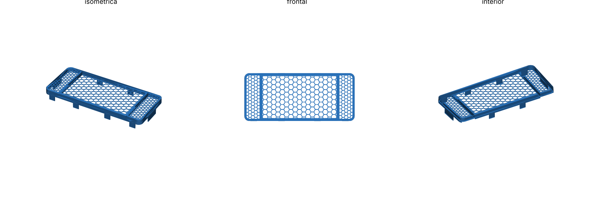

# Visera frontal ultraligera — Nintendo Switch 2

Tapa frontal que protege la pantalla y evita que los joysticks se aplasten en la mochila.
Una "capucha" cubre cada Joy-Con 2 completo, así la posición exacta del stick no importa.
Toda la presión se apoya en el borde exterior y en el marco de la tablet, nunca en sticks ni pantalla.

## Archivos

| STL | Uso | Peso PLA |
|---|---|---|
| `stl/test_clip.stl` | Probar holgura y dedos de agarre (imprímelo primero) | ~11 g |
| `stl/test_hood.stl` | Probar capucha sobre el stick + abrazadera del extremo | ~14 g |
| `stl/a1_plate.stl` | **Bambu A1**: las dos mitades ya boca abajo en una cama de 256 mm (247 × 138 mm) | ~61 g |
| `stl/left.stl` + `stl/right.stl` | Las mitades por separado (orientación de modelado) | ~31 g c/u |
| `stl/full.stl` | Visera entera, solo para camas ≥ 280 mm | ~55 g |

Regenerar: `openscad -o stl/a1_plate.stl -D 'part="a1_plate"' switch2_visera.scad`
(`part` = `a1_plate | full | left | right | test_clip | test_hood`, `screen_style` = `solid | honeycomb | open`).

## Sujeción (pensada para PLA)

10 puntos de agarre que bajan por el canto y enganchan 1 mm detrás de la consola:

- 2 dedos arriba (x = ±45 mm), lejos de power/volumen, USB-C y L/R.
- 4 dedos abajo (±45 y ±115, este último bajo cada Joy-Con), dejando libre el USB-C central.
- 2 abrazaderas de 40 mm que envuelven los extremos redondeados de los Joy-Con.
- Ranuras a los lados de cada dedo para que flexione en toda su longitud: deformación ~1 %, segura en PLA.

Si queda floja, sube `clip_hook` a 1.2; si cuesta mucho, bájalo a 0.8 o sube `tol`.

## Impresión (Bambu A1, PLA)

- `a1_plate.stl` ya viene orientado: cara exterior sobre la cama, **sin soportes**.
- 0,2 mm de capa, 3 paredes, relleno 15 % (casi todo son paredes macizas de 1,2–1,6 mm).
- Unión de las mitades: pegamento (cianoacrilato) en la pestaña central + 3 tornillos M2×8 con tuerca
  (o trozos de filamento de 1,75 mm pegados en los agujeros).
- Ojo: el PLA se deforma por encima de ~55 °C (coche al sol). Para eso, PETG.
- Para quitarla: tira primero de una abrazadera de un extremo.

## Medidas usadas

| Medida | Valor | Fuente | Confianza |
|---|---|---|---|
| Consola con Joy-Con 2 | 272 × 116 × 13,9 | Nintendo oficial | Alta |
| Grosor máx. punta stick → ZL/ZR | 30,7 | Nintendo oficial | Alta |
| Tablet sin Joy-Con (ancho) | 200–201 | couple-game.net, escaneo dbrand | Media-alta |
| Ancho visible Joy-Con 2 | ~35,5 | (272 − 201) / 2 | Media |
| Diámetro capuchón stick | 17,2–17,5 | Bitbuilt, GamesRadar | Media-alta |
| Altura del stick sobre la cara | 6,3–7,2 (se usa 7,2) | dbrand; 30,7 − 14,4 − 9,1 | Media |
| ZL/ZR sobresalen por detrás | 9,1 | dbrand | Media |
| Pantalla activa | ~174,9 × 98,4 | 7,9″ 16:9 | Alta |
| Marco lateral pantalla–borde tablet | ~13 (lados), ~8,8 (arriba/abajo) | Estimado | Baja-media |
| Centros de los sticks | izq. ~35 mm desde arriba, der. ~70 mm; ~17–18 mm del borde exterior | Estimación, **no publicado** | Baja |
| Botones | ABXY y cruceta sobresalen ~1,6 mm (por debajo del stick) | dbrand | Media |
| Borde superior (izq → der) | Power, volumen, ventilación, USB-C (a la dcha. del centro), jack 3,5, ranura de juego | Diagrama Nintendo | Orden sí, posiciones no |
| Borde inferior | Altavoz, USB-C central, altavoz | Diagrama Nintendo / iFixit | Media-alta |
| Radio de esquinas | no publicado (se usa 11) | — | Medir |

Como las capuchas cubren todo el Joy-Con, la posición de sticks y botones no afecta al encaje.
Lo que sí conviene medir con calibre: `corner_r` y que los clips (`top_clips`, `bottom_clips`, en mm desde el centro)
no tapen la ranura de juego, el jack ni los altavoces de tu consola.

Fuentes: [Nintendo specs](https://www.nintendo.com/en-gb/Hardware/Nintendo-Switch-2/Nintendo-Switch-2-Specifications-2785627.html),
[Joy-Con 2](https://www.nintendo.com/my/hardware/switch2/accessories/joyCon.html),
[diagrama de la consola](https://en-americas-support.nintendo.com/app/answers/detail/a_id/68498),
[couple-game.net](https://couple-game.net/switch2-size/),
[dbrand vía Nintendo Life](https://www.nintendolife.com/news/2024/12/after-sharing-switch-2-images-dbrand-is-back-with-actual-measurements),
[Bitbuilt (stick)](https://bitbuilt.net/forums/threads/nintendo-switch-2-hall-effect-analog-stick-pinout-3d-model.7271/),
[GamesRadar](https://gamesradar.com/hardware/gaming-controllers/nintendo-switch-2-joy-cons-compared-how-do-the-new-controllers-stack-up-against-the-ones-we-know),
[modelo de referencia escaneado (MakerWorld)](https://makerworld.com/en/models/1490513-nintendo-switch-2-reference-model).
