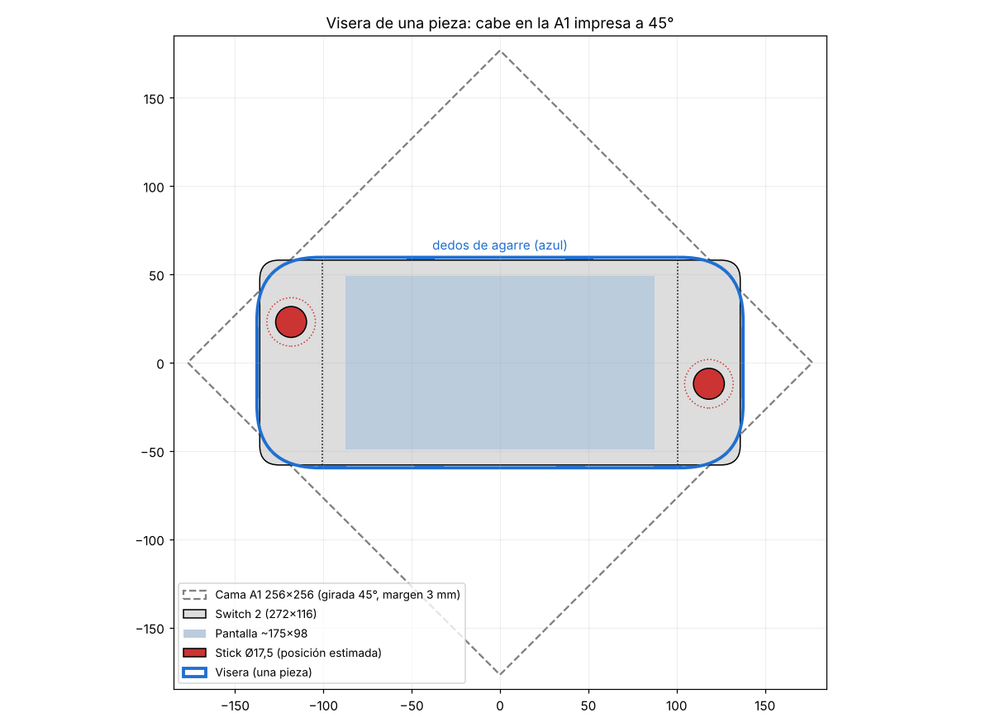

# Visera frontal reforzada — Nintendo Switch 2

Tapa frontal de una pieza que protege la pantalla y evita que los joysticks se aplasten
en la mochila. Una "capucha" hueca cubre cada Joy-Con 2 entero, así la posición exacta
del stick no importa (Nintendo no la publica). Toda la presión se apoya en el borde
exterior y en el marco de la tablet, nunca en sticks ni pantalla.

Diseño validado por elementos finitos (ver [Simulaciones](#simulaciones)).

## Archivos

| Archivo | Uso | Peso PLA / PETG |
|---|---|---|
| `visera_switch2_A1_PETG.3mf` | **Recomendado.** Proyecto Bambu Studio listo: A1 0.4, PETG HF, placa PEI texturizada | — / ~173 g |
| `visera_switch2_A1_PLA.3mf` | Igual con PLA Basic | ~169 g / — |
| `stl/test_clip.stl` | Probar holgura y dedos de agarre (imprímelo primero) | ~19 g |
| `stl/test_hood.stl` | Probar capucha sobre el stick + abrazadera del extremo | ~30 g |
| `stl/a1_diag.stl` | Visera de una pieza ya girada 45° y boca abajo (249,6 × 249,6 mm) | ~169 / 173 g |
| `stl/full.stl` | La misma visera sin girar (para mirarla o para camas ≥ 280 mm) | ~169 / 173 g |

Los 3MF llevan: capa 0,2 mm, 4 paredes, gyroid 25 %, 5/4 capas sup./inf., sin soportes,
sin brim, costura atrás. Se generan con `python3 tools/make_3mf.py stl/a1_diag.stl salida.3mf --filament pla|petg`
a partir de los perfiles oficiales de Bambu (`tools/bbl_a1_presets.json`).
No se han abierto en Bambu Studio desde este entorno: si algo no carga, abre `stl/a1_diag.stl`.

**Por qué cabe en la A1:** un cuadrado de 256 mm girado 45° admite piezas de hasta ~360 mm
si las esquinas están redondeadas. Por eso las esquinas de la visera tienen radio ~35 mm
(`cover_r`, calculado a partir de `bed`). En cada esquina queda al aire un pequeño triángulo
de la cara frontal, donde no hay botones.

Regenerar: `openscad -o stl/a1_diag.stl switch2_visera.scad`
(`part` = `a1_diag | full | test_clip | test_hood | left | right`).

## Estructura

- **Sobre la pantalla:** piel maciza de 1,4 mm + panal hexagonal de 10,6 mm de profundidad
  por dentro. Fuera de la pantalla los nervios bajan en rampa de 45° hasta el apoyo (sin esquinas vivas).
  Quedan 3,8 mm de aire hasta la pantalla.
- **Capuchas:** techo de 2,6 mm + panal de 3,4 mm (nervios de 1,8 mm) + refuerzo a 45° en la
  pared de apoyo. Quedan 2,6 mm de aire sobre la punta del stick (stick estimado en 7,2 mm).
- **Grosor total** con la consola: 31,7 mm.

## Sujeción

8 puntos de agarre que bajan por el canto y enganchan 1 mm detrás de la consola:

- 2 dedos arriba (x = ±45 mm), lejos de power/volumen, USB-C y L/R.
- 4 dedos abajo (±40 y ±95), dejando libre el USB-C central.
- 2 abrazaderas de 40 mm que envuelven los extremos redondeados de los Joy-Con.
- Cada dedo arranca casi arriba de la pared (`finger_root_z`), con redondeo en la raíz y
  agujeros de alivio al final de las ranuras: así flexiona a lo largo de ~26 mm con poca tensión.

Si queda floja, sube `clip_hook` a 1.2; si cuesta mucho, bájalo a 0.8 o sube `tol`.

**Imanes (opcional, experimental):** `magnets = true` añade 4 alojamientos para imanes de
6 × 2 mm sobre la junta Joy-Con/tablet, donde la consola tiene sus propios imanes. Prueba antes
con un imán suelto que se pegue y que la consola no reaccione (reposo, detección de mandos).

## Impresión

- El 3MF / `a1_diag.stl` ya viene orientado (45°, cara exterior sobre la cama): **no lo gires**, **sin soportes**.
- **PETG recomendado** para la mochila: más tenaz (se dobla en vez de partirse), aguanta ~75–80 °C
  (PLA ~55 °C) y se deforma menos con presión continua.
- Para quitarla: tira primero de una abrazadera de un extremo.

## Simulaciones

FEA lineal con CalculiX (tetraedros cuadráticos C3D10, malla gmsh), en `sim/`:
`sim/run_all.sh` ejecuta todos los casos; `sim/fea.py <caso> <material>` uno.
Material impreso conservador: PLA E = 3000 MPa, 45 MPa en el plano, 25 MPa entre capas;
PETG E = 1900 MPa, 40 / 28 MPa. Margen = resistencia / tensión máxima (pico real, solo se
excluyen los nodos a < 1,5 mm de cargas o apoyos impuestos). La visera se imprime boca abajo,
así que la tensión entre capas es σzz del modelo.

| Caso | Carga | Tensión máx. (PLA) | Margen PLA (plano / entre capas) | Margen PETG | Hundimiento → aire disponible |
|---|---|---|---|---|---|
| Rodilla sobre la pantalla | 300 N (~30 kg) en Ø20 mm, centro | 26,3 MPa | **1,7× / 3,8×** | ~1,5× | 0,75 mm (PETG 1,2) → 3,8 mm: no toca |
| Rodilla sobre el stick | 300 N en Ø20 mm, capucha derecha | 33,1 MPa | **1,4× / 2,6×** | ~1,2× (dúctil) | 0,35 mm (PETG 0,55) → 2,6 mm: no toca |
| Mochila aplastada | 500 N (~50 kg) repartidos | 12,9 MPa | **3,5× / 5,1×** | ~3,1× | 0,23 mm |
| Poner / quitar la visera | gancho se abre 0,6 mm | 11,4 MPa entre capas | **2,2×** entre capas | **4,0×** | — |

Con carga impuesta la tensión casi no depende del material y el hundimiento escala con 1/E;
se comprobó simulando la pantalla también en PETG (28,5 vs 28,7 MPa; 0,85 vs 1,32 mm).

Iteraciones que salieron de las simulaciones:

1. Dedos de agarre: margen entre capas 1,2× → raíz alta, redondeo y agujeros de alivio → 2,2× (PLA).
2. Placa de 1,2 mm sobre la pantalla: con 30 kg se hundía hasta tocarla → panel nervado profundo.
3. Esquinas vivas nervio/pared → rampas de 45° y refuerzos.
4. Techo de capucha de 2 mm: 51 MPa → panal bajo el techo y techo de 2,6 mm.

Limitaciones: análisis lineal y estático (no simula impactos ni fatiga), contacto con la
consola modelado como apoyo simple, propiedades de material genéricas. Las medidas de la
consola son en parte estimadas: imprime los probadores antes.

## Medidas usadas

| Medida | Valor | Fuente | Confianza |
|---|---|---|---|
| Consola con Joy-Con 2 | 272 × 116 × 13,9 | Nintendo oficial | Alta |
| Grosor máx. punta stick → ZL/ZR | 30,7 | Nintendo oficial | Alta |
| Tablet sin Joy-Con (ancho) | 200–201 | couple-game.net, escaneo dbrand | Media-alta |
| Ancho visible Joy-Con 2 | ~35,5 | (272 − 201) / 2 | Media |
| Diámetro capuchón stick | 17,2–17,5 | Bitbuilt, GamesRadar | Media-alta |
| Altura del stick sobre la cara | 6,3–7,2 (se usa 7,2) | dbrand; 30,7 − 14,4 − 9,1 | Media |
| ZL/ZR sobresalen por detrás | 9,1 | dbrand | Media |
| Pantalla activa | ~174,9 × 98,4 | 7,9″ 16:9 | Alta |
| Marco lateral pantalla–borde tablet | ~13 (lados), ~8,8 (arriba/abajo) | Estimado | Baja-media |
| Centros de los sticks | izq. ~35 mm desde arriba, der. ~70 mm; ~17–18 mm del borde exterior | Estimación, **no publicado** | Baja |
| Botones | ABXY y cruceta sobresalen ~1,6 mm (por debajo del stick) | dbrand | Media |
| Borde superior (izq → der) | Power, volumen, ventilación, USB-C (a la dcha. del centro), jack 3,5, ranura de juego | Diagrama Nintendo | Orden sí, posiciones no |
| Borde inferior | Altavoz, USB-C central, altavoz | Diagrama Nintendo / iFixit | Media-alta |
| Radio de esquinas | no publicado (se usa 11) | — | Medir |

Conviene medir con calibre `corner_r`, la altura real del stick (`stick_h`) y comprobar que los
clips (`top_clips`, `bottom_clips`, en mm desde el centro) no tapen la ranura de juego, el jack
ni los altavoces de tu consola.

Fuentes: [Nintendo specs](https://www.nintendo.com/en-gb/Hardware/Nintendo-Switch-2/Nintendo-Switch-2-Specifications-2785627.html),
[Joy-Con 2](https://www.nintendo.com/my/hardware/switch2/accessories/joyCon.html),
[diagrama de la consola](https://en-americas-support.nintendo.com/app/answers/detail/a_id/68498),
[couple-game.net](https://couple-game.net/switch2-size/),
[dbrand vía Nintendo Life](https://www.nintendolife.com/news/2024/12/after-sharing-switch-2-images-dbrand-is-back-with-actual-measurements),
[Bitbuilt (stick)](https://bitbuilt.net/forums/threads/nintendo-switch-2-hall-effect-analog-stick-pinout-3d-model.7271/),
[GamesRadar](https://gamesradar.com/hardware/gaming-controllers/nintendo-switch-2-joy-cons-compared-how-do-the-new-controllers-stack-up-against-the-ones-we-know),
[modelo de referencia escaneado (MakerWorld)](https://makerworld.com/en/models/1490513-nintendo-switch-2-reference-model).
